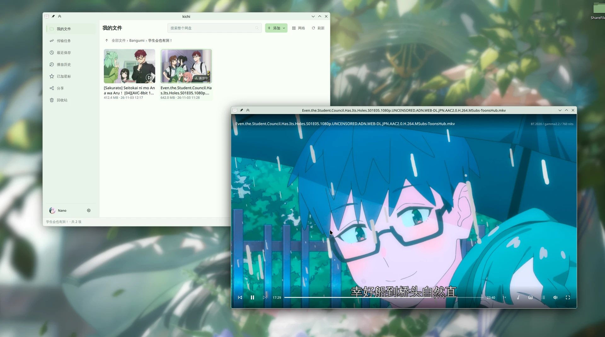

<p align="center">
  
</p>

<h1 align="center">kichi</h1>

<p align="center">
  <a href="https://github.com/lyndon0na/kichi/actions/workflows/ci.yml">
    
  </a>
</p>

<p align="center">
  PikPak 的第三方 Linux 桌面客户端。
</p>

kichi 用 Rust + Qt 6（cxx-qt + QML）写成，界面跟随系统外观，目标是做成一个
日常可用的原生桌面应用，而不是网页套壳。

KDE 会话使用 `org.kde.desktop`（Breeze 外观，配色与强调色来自 Plasma）；
其他桌面使用完全由 `QPalette` 驱动的 Fusion，并通过 XDG Desktop Portal 的
`org.freedesktop.appearance` 读取系统深色偏好与强调色。源码运行、AppImage 和
Flatpak 走同一套逻辑。

> **非官方项目**：与 PikPak 官方没有任何关系。客户端使用第三方接口，接口随时可能变化；
> 请自行确认使用方式符合服务条款，风险自负。

<p align="center">
  <a href="docs/screenshots/main-window.webp">
    
  </a>
</p>
<p align="center"><sub>主界面与内嵌播放器</sub></p>

## 功能

| 模块 | 内容 |
| --- | --- |
| 账号 | 登录 / 退出、人机验证、令牌存入系统钥匙串、自动刷新、容量与会员信息 |
| 文件 | 列表 / 网格浏览、面包屑、排序、搜索、新建文件夹、重命名、移动、复制、回收站 |
| 离线任务 | HTTP 链接、磁力链接、`.torrent` 文件，多行批量提交，任务进度与删除 |
| 下载 | 队列、暂停 / 继续、断点续传、并发与分片、限速、历史记录、系统通知 |
| 上传 | 文件 / 文件夹、拖放、multipart 断点、限速、自动续传（可选） |
| 分享 | 创建分享、管理列表、批量撤销 |
| 资料库 | 最近保存、播放历史、已加星标 |
| 播放 | 内嵌 libmpv（Wayland）、外部 mpv / VLC（Flatpak 版仅内嵌）、清晰度选择、外挂字幕、续播、文件夹连播 |
| 桌面集成 | 系统托盘、单实例、系统深色模式与强调色、中文界面 |

## 环境要求

- Linux，推荐 Wayland 会话
- 系统钥匙串（KWallet / Secret Service）用于保存登录令牌；不可用时降级为 0600 文件
- XDG Desktop Portal（文件选择、目录选择）
- 内嵌播放需要 Wayland 会话；没有 `WAYLAND_DISPLAY` 时自动回退外部 mpv
  （Flatpak 版没有外部回退，只提示需要 Wayland）

## 构建

需要 Rust 工具链和以下系统依赖（Fedora 包名）：

```bash
sudo dnf install qt6-qtbase-devel qt6-qtdeclarative-devel \
    kf6-kirigami kf6-qqc2-desktop-style mpv-devel cmake gcc-c++
```

Debian / Ubuntu 对应的包名是 `qt6-base-dev`、`qt6-declarative-dev`、
`qml6-module-org-kde-kirigami`、`qml6-module-org-kde-qqc2desktopstyle`（发行版
拆包时名称可能略有不同）、`libmpv-dev`、`cmake`、`g++`。

`kf6-kirigami` 提供 `KTheme` 使用的动效时长令牌；`kf6-qqc2-desktop-style`
只在 KDE 会话下用于原生 Breeze 控件，非 KDE 桌面会改用 Qt 自带的 Fusion。

```bash
git clone https://github.com/lyndon0na/kichi.git
cd kichi
cargo build --workspace
./target/debug/kichi
```

Release 构建：

```bash
cargo build --release
./target/release/kichi
```

### AppImage

需要 `patchelf >= 0.18`（Fedora：`sudo dnf install patchelf`），脚本目前只支持 x86_64；
`linuxdeploy` 等工具会自动下载并校验。

```bash
./scripts/build-appimage.sh
```

产物在 `dist/`，运行：

```bash
chmod +x dist/kichi-*.AppImage
./dist/kichi-*.AppImage
```

脚本按当前构建机的 glibc 版本打包，不承诺跨发行版兼容；
KWallet、XDG Portal、系统主题、Breeze 图标、mpv / VLC 仍使用宿主环境。

### Flatpak

需要 `flatpak-builder`、`org.kde.Platform//6.11`、`org.kde.Sdk//6.11` 和
`org.freedesktop.Sdk.Extension.rust-stable//25.08`：

```bash
flatpak install flathub org.kde.Platform//6.11 org.kde.Sdk//6.11
flatpak install flathub org.freedesktop.Sdk.Extension.rust-stable//25.08
# 如果发行版的 flathub 远程带过滤、装不到 rust extension：
# flatpak remote-add --user --if-not-exists flathub-full https://dl.flathub.org/repo/flathub.flatpakrepo
# flatpak install --user flathub-full org.freedesktop.Sdk.Extension.rust-stable//25.08

./scripts/build-flatpak.sh
flatpak install --user dist/io.github.lyndon0na.kichi-*.flatpak
flatpak run io.github.lyndon0na.kichi
```

Flatpak 包内自带 libmpv 及其依赖，内嵌播放不依赖宿主安装 mpv。Flatpak 版只提供
内嵌播放器：设置页不显示外部 mpv / VLC / 自定义播放器选项，因为沙箱内看不到也无法
启动宿主播放器。需要外部播放器时请使用 AppImage 或自行构建。

## 测试

```bash
cargo test --workspace      # 单元测试
./scripts/qml-lint.sh       # QML 静态检查 + QtQuick Test
```

真实账号测试默认标了 `--ignored`，需要本机已登录并提供测试账号，会真实读写云端数据。

## 数据位置

- 设置与传输记录：`$XDG_CONFIG_HOME/kichi/`（默认 `~/.config/kichi/`）
- 登录令牌：系统钥匙串（`kichi` service）；钥匙串不可用时才落到 0600 文件
- 下载断点：下载根目录下的 `.kichi-part` 与配置目录下的 `partials.json`

所有网络请求只发往 `user.mypikpak.com`、`api-drive.mypikpak.com` 及下载 CDN；
账号头像下载额外访问 `lh3.googleusercontent.com`。没有遥测、上报或统计。

## 已知限制

- 主要针对 Wayland 开发和验证；非 KDE 桌面使用 Fusion，并按 XDG Desktop Portal
  跟随深色模式与强调色，其他桌面环境尚未逐一实机验证
- PikPak 接口没有公开文档，字段和错误码可能随官方变动
- 内嵌播放窗口的行为仍在实机打磨中

## 参考项目

接口实现和播放器方案参考了以下项目，具体许可证与使用范围见
[THIRD_PARTY_NOTICES.md](THIRD_PARTY_NOTICES.md)。

| 项目 | 许可证 | 参考内容 |
| --- | --- | --- |
| [rclone](https://github.com/rclone/rclone) 的 PikPak 后端 | MIT | 端点常量、设备 ID / captcha 签名算法与部分请求形状；部分代码已移植 |
| [pikpak-kotlin](https://github.com/NihilDigit/pikpak-kotlin) | MIT | 部分接口字段与请求形状 |
| [pikpaktui](https://github.com/Bengerthelorf/pikpaktui) | Apache-2.0 | 分享、任务与选链等请求形状 |
| [Mutsumi](https://github.com/MutsumiUniverse/Mutsumi) | MIT | 内嵌播放器的 libmpv + Wayland 代理思路 |

图标路径来自 [Tabler Icons](https://github.com/tabler/tabler-icons)（MIT），
Wayland 客户端协议代码由 [wayland-protocols](https://gitlab.freedesktop.org/wayland/wayland-protocols)
（MIT）生成。

## 许可证

项目以 [GPL-3.0-or-later](LICENSE) 发布。直接借用的第三方代码、图标数据以及随
AppImage 分发的 Qt / KDE 运行时组件，见 [THIRD_PARTY_NOTICES.md](THIRD_PARTY_NOTICES.md)。
